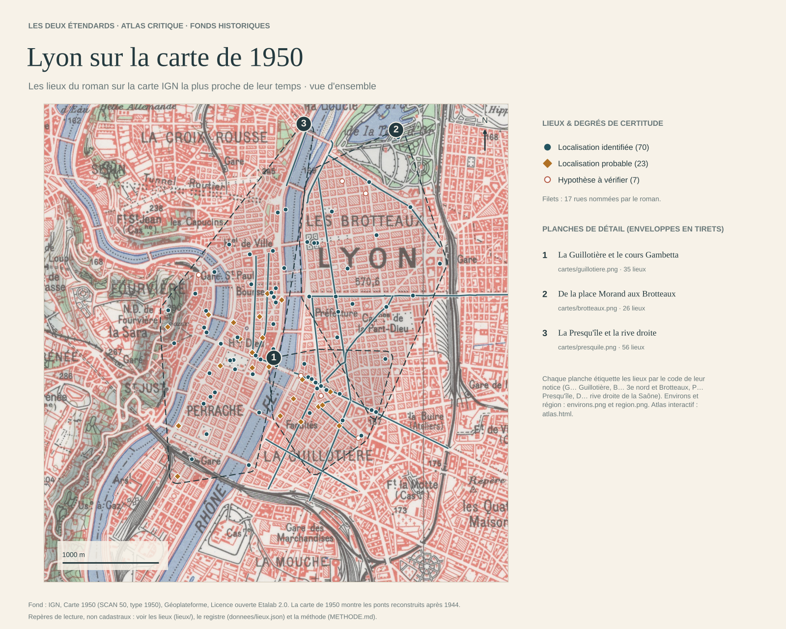

# Les lieux lyonnais des *Deux Étendards*

Ce dossier identifie et cartographie les lieux lyonnais du roman de Lucien Rebatet, *Les Deux Étendards* (Gallimard, 1951). Il en fait l'enquête sur trois plans : philologique, historique et géographique. Les références renvoient au témoin EPUB placé dans [`DeuxÉtendards/`](../) : « XII §124 » désigne le 124e paragraphe du chapitre XII (voir [METHODE](METHODE.md)).

Le registre [`donnees/lieux.json`](donnees/lieux.json) compte **162 lieux**, dont 146 sont cartographiés :

| Statut | Lieux |
|---|---:|
| identifiés | 105 |
| probables | 29 |
| hypothèses | 12 |
| non localisés, hors carte | 16 |

Ces nombres comptent des objets de natures différentes : une rue, un café, un surnom, une zone de recherche. Ils ne signifient pas que 162 bâtiments ont été retrouvés.



## Principaux résultats

| Lieu du roman | Résultat | Certitude |
|---|---|---|
| Domiciles du cours Gambetta ([G08](lieux/G_Guillotiere.md#g08), [G10](lieux/G_Guillotiere.md#g10)) | Le roman loge les Villars « au 3 bis du Cours Gambetta » (XXIX §106). Les recensements placent leur modèle, la famille Chevallier, au n° 5, à l'angle de la rue Mortier, en 1926 et 1931. Le modèle des Lanthelme, la famille Varillon, habite le n° 28 en 1921 et 1926. Seul le n° 26 sépare cette adresse des Grandes Galeries Modernes ([G11](lieux/G_Guillotiere.md#g11)), sous la « marquise » desquelles s'ouvre la porte des Lanthelme (XXXVII §160). | Établi par les recensements et les plans parcellaires. Depuis la place Antique, les deux domiciles sont à 196 et 296 m ; le roman dit « deux cents » et « trois cents » mètres (IX §84). |
| Café des Alpes ([B02](lieux/B_Brotteaux.md#b02)) | Le roman en fait un café populaire de l'avenue de Saxe (X §149), à un angle situé « un peu après le cours La Fayette » quand on vient de la place Morand (XXII §34-35). | La voie et le tronçon sont attestés. Ni l'angle, ni l'immeuble, ni l'enseigne réelle ne sont établis. |
| Rue du Six-Janvier ([B01](lieux/B_Brotteaux.md#b01)) | C'est le surnom de la rue Créqui. Le souvenir se rattache à l'angle de la rue Rabelais (XII §124). La date du 6 janvier 1925 est confirmée par le journal de Rebatet (Ifri 2001). | Le carrefour est certain. |
| Place Antique ([G01](lieux/G_Guillotiere.md#g01)) | C'est le carrefour des rues Saint-Michel, Béchevelin et de la Vierge (rue Gilbert-Dru depuis 1945). En face s'élève l'« école neuve », achevée en 1924 (IX §85). | Probable : faisceau d'indices. |
| Chambre de Michel chez les « Mulet » ([G07](lieux/G_Guillotiere.md#g07)) | Le modèle probable est le ménage Mulnet, imprimeur au *Progrès*. Il habite le n° 294 de l'avenue Jean-Jaurès en 1921 et 1926. L'immeuble, aujourd'hui le n° 32, donne sur la rue Saint-Michel, qui mène à la place Antique. | Très probable. Rebatet n'est pas inscrit à cette adresse au recensement de mars 1926. |
| Banc du « quai Perrache » ([P23](lieux/P_Presquile.md#p23)) | Le paysage décrit (la Saône, Fourvière, un pont ferroviaire, un tunnel) n'est pas celui du quai Perrache officiel, qui borde le Rhône. | Zone probable sur l'ancien quai d'Occident (quai Maréchal-Joffre). Le banc n'est pas placé. |
| Cafés Morel et Royal ([P03](lieux/P_Presquile.md#p03), [P04](lieux/P_Presquile.md#p04)) | Une annonce de 1884 place l'« Ancien café Morel » à l'angle de Bellecour et de la rue de l'Hôtel-de-Ville. Le Royal correspond probablement au café du 50 rue de la République, attesté par une publicité de 1929. | Probables. La continuité de ces enseignes reste à recouper dans les indicateurs. |
| Hôtel Lugdunum ([B13](lieux/B_Brotteaux.md#b13)) | C'est un hôtel réel des Brotteaux, place Jules-Ferry. La chambre 348 du roman porte le numéro de la cellule de Rebatet à Fresnes. | Identifié. |
| Cercle du P. Rollet ([G30](lieux/G_Guillotiere.md#g30)) | Son modèle est la Maison des étudiants catholiques, 4 rue Montesquieu. Varillon, modèle de Régis, y connut le P. Roullet. | Modèle probable. |
| Bibliothèque de la Ville ([D04](lieux/D_Rive_droite.md#d04)) | Elle occupe le palais Saint-Jean, siège de la bibliothèque municipale de 1912 à 1972. | Identifiée. Il ne faut pas la placer à la Part-Dieu. |

## Cartes

- La [vue d'ensemble](cartes/lyon_1950.png), sur la carte IGN de 1950.
- Trois planches sur les photographies aériennes de 1950-1965 : la [Guillotière](cartes/guillotiere.png), les [Brotteaux](cartes/brotteaux.png), la [Presqu'île et la rive droite](cartes/presquile.png). Deux planches sur la carte de 1950 : les [environs](cartes/environs.png) et la [région](cartes/region.png).
- Les [cinq itinéraires reconstitués](cartes/itineraires.png), avec une [planche par trajet](cartes/itineraires/).
- L'[atlas interactif](cartes/atlas.html), sur fonds IGN historiques ou OpenStreetMap. Il faut télécharger le fichier et l'ouvrir dans un navigateur : GitHub n'en affiche que le code.

Les repères portent le code de leur notice. Leur couleur et leur forme distinguent l'identification, la probabilité et l'hypothèse. Les segments et les zones marquent une emprise ou une marge de recherche, non une adresse. Les fonds de 1950 sont plus proches de la ville de 1925 qu'un plan actuel, mais ils lui sont postérieurs d'une génération : on y voit par exemple les ponts du Rhône reconstruits après 1944.

## Contenu

| Chemin | Contenu |
|---|---|
| [`lieux/`](lieux/) | Les 162 notices, classées par secteur : [Guillotière](lieux/G_Guillotiere.md), [Brotteaux](lieux/B_Brotteaux.md), [Presqu'île](lieux/P_Presquile.md), [rive droite](lieux/D_Rive_droite.md), [environs](lieux/E_Environs.md), [région](lieux/R_Region.md). Elles sont produites à partir du registre et donnent les occurrences dans le roman. |
| [`dossiers/`](dossiers/) | Huit dossiers thématiques : [café des Alpes](dossiers/01_cafe_des_alpes.md), [toponymes et adresses](dossiers/02_toponymes_et_adresses.md), [établissements](dossiers/03_etablissements.md), [lieux religieux et d'enseignement](dossiers/04_religieux_et_enseignement.md), [témoins et modèles](dossiers/05_temoins_et_modeles.md), [itinéraires](dossiers/06_itineraires.md), [géographie critique](dossiers/07_geographie_critique.md), [toponymie de 1925](dossiers/08_toponymie_1925.md). |
| [`donnees/`](donnees/) | Le registre et son export GeoJSON ; les itinéraires et leurs tracés ; le fond OpenStreetMap et sa provenance ; l'inventaire lexical. |
| [`cartes/`](cartes/) | Les cartes PNG et l'atlas. |
| [`outils/`](outils/) | Les scripts Python. |
| [METHODE.md](METHODE.md) | La méthode : preuves, statuts et degrés de certitude, critique du texte et des témoignages, cartes, schéma des données, contrôles. |
| [SOURCES.md](SOURCES.md) | Les sources, la bibliographie critique et les [pièces à consulter](SOURCES.md#pieces). |

## Portée

*Les Deux Étendards* est un roman à clef. Commencé sous l'Occupation, il a été achevé en prison entre 1946 et 1950, une vingtaine d'années après les faits. Rebatet avoue avoir amplifié ou inventé plusieurs épisodes, et avoir substitué des lieux fictifs à « quelques décors accessoires ». Les témoignages et les archives éclairent donc le *modèle* d'un lieu ; ils ne prouvent pas à eux seuls la topographie du roman.

L'enquête distingue le texte, l'histoire du lieu et la géographie actuelle. Elle écarte aussi plusieurs faux amis : dans les passages concernés, la rue de Fleurus et le Marivaux sont parisiens ; la Chauve-Souris est une personne ; le cours Boudier est un établissement d'enseignement.

## Reproduire

Depuis ce dossier, avec Python 3.10 ou ultérieur :

```sh
python3 outils/verifier.py                  # contrôle le témoin, les références, l'inventaire, les géométries et les liens
python3 outils/fiches.py                    # produit lieux/ et donnees/lieux.geojson à partir du registre
python3 outils/itineraires.py               # trace les itinéraires (networkx, pyyaml)
python3 outils/cartes.py                    # produit cartes/ (matplotlib, pillow, shapely ; tuiles IGN gardées en cache)
python3 outils/corpus.py show XII 124 126   # affiche des paragraphes du témoin
```

`verifier.py`, `fiches.py` et `corpus.py` n'emploient que la bibliothèque standard. Les fichiers produits ne se corrigent pas à la main : on corrige le registre, puis on relance les scripts.
