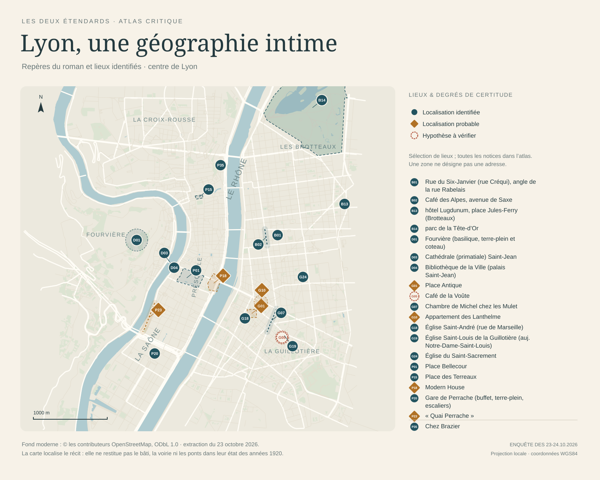
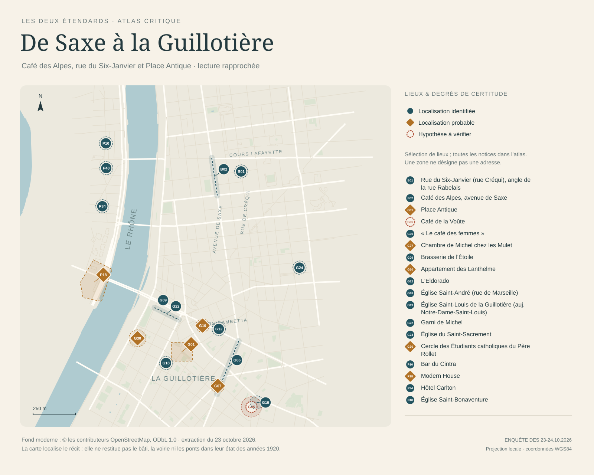

# Cartes de l'enquête lyonnaise

- **[Atlas interactif autonome](atlas_lyon.html)** : toutes les notices, recherche, filtres de certitude, zoom et déplacement. Télécharger le fichier HTML puis l'ouvrir dans un navigateur : carte, recherche et notices fonctionnent sans connexion ; les liens vers les sources et vers les fiches (GitHub) en demandent une. GitHub affiche le code HTML, pas l'application.
- **[Lyon, une géographie intime](lyon_ensemble.svg)** : sélection éditoriale de repères du centre de Lyon, en SVG vectoriel.
- **[De Saxe à la Guillotière](lyon_guillotiere_saxe.svg)** : lecture rapprochée centrée sur trois lieux majeurs : rue du Six-Janvier (carrefour Créqui/Rabelais, identifié), Café des Alpes (corridor de recherche avenue de Saxe, probable), Place Antique (zone probable). Elle montre aussi les dix autres notices localisées dans le cadre (13 au total), en SVG vectoriel.





## Lire les symboles

| Symbole | Signification |
|---|---|
| Cercle bleu | Identification géographique retenue ; voir la notice pour la preuve historique |
| Losange ocre | Localisation probable, avec une inférence à contrôler |
| Cercle rouille pointillé | Hypothèse de travail |
| Halo, segment ou surface translucide | Emprise du lieu ou marge spatiale indicative ; jamais un numéro de voirie |
| Notice sans marqueur | Lieu non localisé, hors du cadre ou, sur les cartes statiques, non retenu dans la sélection ; l'atlas montre toutes les notices localisées dans le cadre |

Les numéros renvoient à l'ordre des notices de `lieux.json`, commun aux deux cartes et à l'atlas. Ils ne sont pas des numéros de rue. Les repères d'une ligne ou d'une surface sont des renvois graphiques : leur position n'établit aucun bâtiment. Les degrés portent sur l'identification géographique, distincte de l'attestation de l'expression dans le roman.

Le café des Alpes apparaît sous la forme d'un corridor de recherche avenue de Saxe, **sans adresse prétendument retrouvée**. La Place Antique est une zone probable près de l'ancienne rue de la Vierge. Le « quai Perrache » du roman est décrit au bord de la Saône, avec Fourvière en face (XII §§166–168 ; voir aussi XXXVII §68). Il ne coïncide pas avec le quai Perrache officiel, qui longeait déjà le Rhône au temps du récit (ancienne chaussée Perrache, dénommée quai en 1890). La discordance ne vient donc pas d'un changement de nom postérieur. Aucune source consultée n'atteste ce nom pour la rive de Saône. Le texte signale d'ailleurs que Michel l'avait d'abord pris pour le quai de la gare (XII §172). Le banc reste non localisé ; l'hypothèse à examiner est la rive gauche de la Saône, aux abords du viaduc ferroviaire de la Quarantaine (voir [la fiche des toponymes, §6](../03_Fiches/02_toponymes_et_adresses.md)).

## Fond et limites

Le fond est un **état moderne**, extrait d'OpenStreetMap le 23 octobre 2026. Il sert à situer le récit et **ne restitue pas Lyon en 1925**. Notamment les ponts, équipements, limites et voies peuvent être postérieurs au roman. Les grands noms de quartiers et de fleuves sont des étiquettes d'orientation ajoutées par l'enquête.

Emprise de la vue générale : longitude 4,810–4,860 ; latitude 45,740–45,780. Les lieux hors cadre restent dans l'index interactif avec la mention « hors cadre ou sans coordonnées ». Une seule notice géolocalisée est dans ce cas : le parc de la Tête-d'Or (n° 16, repère conventionnel à 45,7808° N), qui n'est dessiné sur aucune des trois cartes. Les cartes statiques montrent une sélection, l'atlas contient le registre complet.

Projection locale équirectangulaire, latitude de référence 45,76°, coordonnées d'entrée WGS84. L'échelle est une approximation locale métrique adaptée au centre de Lyon ; ce document ne vise pas la précision cadastrale.

**Crédit obligatoire du fond : © les contributeurs OpenStreetMap.** Données sous [ODbL 1.0](https://opendatacommons.org/licenses/odbl/1-0/) ; [attribution et conditions](https://www.openstreetmap.org/copyright). Le fond simplifié, avec l'identifiant, la version et la date de chaque objet retenu, est conservé dans `../04_Donnees/fond_osm.geojson`. Les requêtes, leurs empreintes et les versions des trois relations d'eau figurent dans `fond_osm_provenance.json`. La sélection conserve les rues, cours d'eau, surfaces en eau et parcs utiles à l'orientation, sans bâtiments. Les surfaces principales en eau proviennent des relations OSM 7317123 (Saône), 11696008 (Rhône) et 255155 (lac de la Tête-d'Or), assemblées par leurs contours. La relation 11696008 (Rhône) n'a pas d'étiquette de nom dans OSM.

## Reproduire

Depuis n'importe quel répertoire, avec Python 3.10 ou ultérieur :

```sh
python /chemin/vers/Rebatet/IdentificationsLieux/Lyon/06_Outils/generer_cartes.py
```

Le script n'utilise que la bibliothèque standard et n'effectue aucune requête réseau. Il lit le registre des lieux et le fond conservé, puis produit les deux SVG, l'HTML et `manifest_cartes.json` (empreintes SHA-256 des entrées et sorties). Les images PNG de ce dossier (fonds IGN de 1950, photographies aériennes 1950-1965, planches d'itinéraires) et `atlas_historique.html` ne sont pas des images de contrôle de ce script : elles sont produites par `06_Outils/cartes_historiques.py`, une autre chaîne de production, et ne sont pas nécessaires à la reproduction des cartes ci-dessus.
