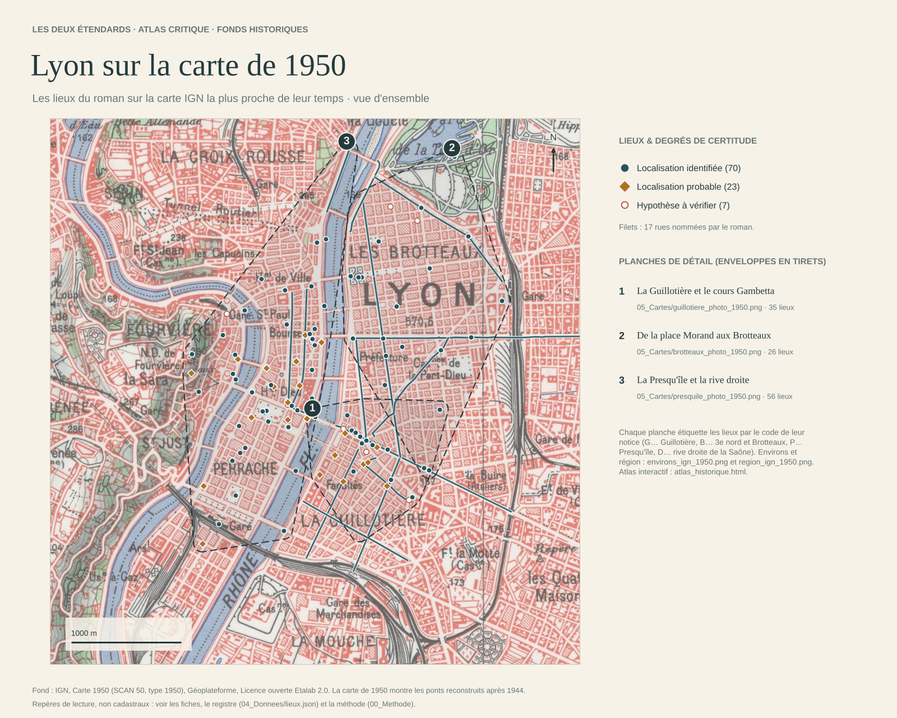
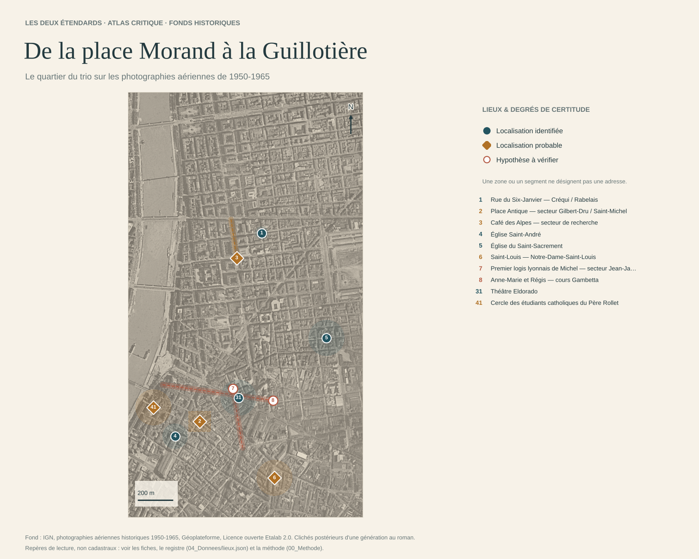

# Lyon dans *Les Deux Étendards*

## Une enquête philologique et historique, avec atlas critique

**État du 24 octobre 2026.** Deux enquêtes indépendantes ont été conduites sur le même témoin. La première procède par dictionnaire lexical et dossiers thématiques ; la seconde par lecture intégrale, en dix tranches. Elles ont été contre-vérifiées l'une par l'autre, puis fusionnées dans un **registre unique de 162 lieux** ([`04_Donnees/lieux.json`](04_Donnees/README.md)), dont 146 sont cartographiés.

| Statut | Lieux |
|---|---:|
| identifiés (`atteste`) | 106 |
| probables | 28 |
| hypothèses | 12 |
| non localisés (sans coordonnées) | 16 |

Chaque lieu a :
- un code de secteur : G Guillotière, B 3e nord et Brotteaux, P Presqu'île, D rive droite de la Saône, E environs, R région ;
- une [fiche par lieu](03_Fiches/par_lieu/README.md) générée depuis le registre, avec ses occurrences dans le roman.

L'inventaire lexical compte 132 entrées et 854 références contrôlées. Les dix [relevés par chapitre](01_Corpus/releves_par_chapitre/README.md) totalisent 4 042 références. Le contrôle automatique vérifie 947 renvois « chapitre § » au texte.

Ces nombres comptent des objets de natures différentes (une rue, un café, un surnom, une zone de recherche) : ils ne signifient pas que 162 bâtiments ont été retrouvés.

**Pour commencer :**
- la [vue d'ensemble sur la carte IGN de 1950](05_Cartes/lyon_carte_ign_1950.png) ;
- les trois planches sur les photographies aériennes de 1950-1965 : [Guillotière](05_Cartes/guillotiere_photo_1950.png), [Brotteaux](05_Cartes/brotteaux_photo_1950.png), [Presqu'île et rive droite](05_Cartes/presquile_photo_1950.png) ;
- les [cinq itinéraires](05_Cartes/itineraires.png) ;
- les deux atlas interactifs : l'[atlas historique](05_Cartes/atlas_historique.html), sur fonds IGN, et l'[atlas autonome](05_Cartes/atlas_lyon.html), sur fond moderne et sans réseau.

Pour utiliser les atlas, télécharger l'HTML et l'ouvrir dans un navigateur ; GitHub n'en affiche que le code.



## Les résultats qui changent la lecture

| Lieu du roman | Résultat de l'enquête | Certitude et réserve |
|---|---|---|
| **Les deux domiciles du cours Gambetta** | Le roman loge les Villars « au 3 bis du Cours Gambetta » (XXIX §106). Les recensements placent leur modèle, la famille Chevallier, au **n° 5**, immeuble d'angle de la rue Mortier, en 1926 et 1931. Les Lanthelme n'ont pas de numéro dans le roman ; leur modèle, la famille Varillon, est au **n° 28**, côté pair, en 1921 et 1926. Les plans parcellaires de 1911 à 1995 établissent la continuité des numéros. Ils montrent aussi qu'aucun « 3 bis » n'existait en 1926. | Lectures d'archives refaites indépendamment. Mesurés depuis la place Antique, les deux domiciles sont à 196 m et 296 m ; le roman dit « deux cents » et « trois cents » mètres (IX §84). [Dossier](03_Fiches/07_temoins_et_modeles.md) |
| **Bazar des « Galeries Modernes »** | La porte des Lanthelme s'ouvre « sous la mesquine marquise » de ce bazar (XXXVII §160). L'enseigne est réelle : les Grandes Galeries Modernes (1908) occupaient l'angle de la place du Pont et du cours Gambetta (n° 22-24 en 1926). Le n° 28 des Varillon n'en est séparé que par le n° 26. | Identifié (plans de 1911 et 1926, permis de 1909, carte postale de 1934). Le débord de la marquise jusqu'au n° 28 n'est pas établi. |
| **Café des Alpes** | C'est la forme lue dans le roman (X §149), et non « Café des Deux Alpes ». C'est un « café populaire de l'avenue de Saxe », à l'un de ses angles, « un peu après le cours La Fayette » en venant de la place Morand (XXII §34-35). | Voie et tronçon attestés par le texte ; ni l'angle, ni l'immeuble, ni l'enseigne réelle ne sont établis. Rebatet se souvient d'un « caboulot » de Pâques 1925. [Dossier](03_Fiches/01_cafe_des_alpes.md) |
| **Rue du Six-Janvier** | Surnom de la rue Créqui (IX §68 ; XIII §13). Le point du souvenir est l'angle de la rue Rabelais, nommé en XII §124. La date du 6 janvier 1925 est confirmée par le journal de Rebatet (Ifri 2001). | Carrefour certain ; trottoir et réverbère inconnus. Simone Chevallier place la rencontre dans « un petit café ». [Dossier](03_Fiches/02_toponymes_et_adresses.md) |
| **Place Antique** | Carrefour des rues Saint-Michel, Béchevelin et de l'ancienne rue de la Vierge (rue Gilbert-Dru depuis 1945). Le groupe scolaire achevé en 1924, avec son horloge d'angle, est l'« école neuve » d'en face (IX §85 ; XII §161). | Probable : faisceau d'indices ; les distances aux deux domiciles réels sont celles du roman. Le surnom date de 1925 (journal de Rebatet). [Dossier](03_Fiches/02_toponymes_et_adresses.md) |
| **Les « Mulet », logeurs de Michel** | « Conducteur d'imprimerie » au *Progrès*, avenue Jean-Jaurès (XIX §133). Les recensements de 1921 et 1926 donnent un imprimeur employé au *Progrès*, au n° 294 de l'avenue (ancienne numérotation), sous un nom qui ne diffère que d'une lettre. | Rapprochement très probable ; lecture d'archives en cours de contre-lecture. Rebatet n'est pas inscrit à cette adresse au recensement de mars 1926. |
| **Banc du « quai Perrache »** | Le paysage décrit la Saône, Fourvière, un pont ferroviaire et un tunnel. Il ne correspond pas au quai Perrache officiel, sur le Rhône. | Zone probable sur l'ancien quai d'Occident (actuel quai Maréchal-Joffre), au nord du pont ferroviaire. Le banc n'est pas placé. Simone Chevallier situe une rencontre « sur le port Rambaud ». [Dossier](03_Fiches/02_toponymes_et_adresses.md) |
| **Lugdunum, Brazier, Grand Théâtre, Rameau, Maison Dorée, Cintra, Carlton** | Bâtiments ou établissements identifiables, avec contrôles de chronologie et de transformations. Le Lugdunum est un hôtel réel. Le numéro de la chambre, 348, est celui de la cellule de Rebatet à Fresnes. | Date du bâtiment, ouverture de l'exploitation et état actuel sont distingués. [Dossiers](03_Fiches/03_etablissements.md) |
| **Bibliothèque au pied de Saint-Jean** | Ancien palais archiépiscopal, siège de la bibliothèque municipale de 1912 à 1972. | Ne pas la déplacer à la Part-Dieu. [Analyse](03_Fiches/04_geographie_critique.md) |
| **Cercle du P. Rollet** | Modèle : la Maison des étudiants catholiques, tenue par les jésuites (ancien Hôtel de la Chanson, 4 rue Montesquieu, sur le quai Claude-Bernard). Varillon, modèle de Régis, y connut le P. Roullet. | Modèle probable, non identité démontrée. [Dossier](03_Fiches/05_religieux_et_enseignement.md) |
| **Morel et Royal** | Le café Morel est à l'angle de Bellecour et de l'ancienne rue de l'Hôtel-de-Ville. Le Royal est un café à orchestre du 50 rue de la République, distinct du Royal-Hôtel. | Probables. Publicités de 1884 et 1929 ; continuité à recouper dans les indicateurs. [Dossier](03_Fiches/04_cafes_morel_royal.md) |



## Comment lire ces cartes

**Fonds.** Les cartes statiques et l'atlas historique emploient la carte IGN de 1950 et les photographies aériennes de 1950-1965. Ces fonds sont plus proches de 1925 qu'un plan actuel, mais postérieurs d'une génération : les ponts du Rhône y sont reconstruits, plusieurs îlots ont changé. L'atlas autonome et les cartes SVG emploient un fond moderne (OpenStreetMap).

**Repères.** Ils sont étiquetés par le code de leur notice (G10, B02…), comme les fiches. La forme et la couleur de l'étiquette distinguent identification, probabilité et hypothèse. Les zones, les segments et les cercles expriment une emprise ou une marge de recherche, pas une adresse. Les 16 lieux non localisés restent hors carte, sans coordonnées fictives.

Les coordonnées sont des repères de lecture. Ni la précision des décimales ni un résultat de géocodage n'établissent une parcelle historique ; la forme de l'incertitude est conservée dans le [GeoJSON](04_Donnees/lieux.geojson).

## Architecture de l'enquête

| Dossier | Contenu |
|---|---|
| [00_Methode](00_Methode/PROTOCOLE.md) | Protocole : preuves, statuts et degrés de certitude, deux numérotations, témoignages et archives nominatives, itinéraires, fonds historiques |
| [01_Corpus](01_Corpus/NOTICE.md) | Témoin EPUB, empreinte, convention de paragraphes ; [inventaire](01_Corpus/INVENTAIRE.md) ; [relevés par chapitre](01_Corpus/releves_par_chapitre/README.md) ; [index des occurrences](01_Corpus/index_occurrences.md) ; table de concordance des numérotations |
| [02_Sources](02_Sources/BIBLIOGRAPHIE.md) | Sources institutionnelles, archives, critique, témoignages, ouvrages repérés mais non consultés |
| [03_Fiches](03_Fiches/) | Neuf dossiers thématiques (café des Alpes, toponymes et adresses, établissements, Morel et Royal, géographie critique, religieux et enseignement, toponymie de 1925, témoins et modèles, itinéraires) et les [162 fiches par lieu](03_Fiches/par_lieu/README.md) |
| [04_Donnees](04_Donnees/README.md) | Registre unique (JSON, GeoJSON, CSV), itinéraires, fond OSM, géocodages, inventaire |
| [05_Cartes](05_Cartes/README.md) | Vue d'ensemble, planches par secteur, environs, région, itinéraires, atlas |
| [06_Outils](06_Outils/) | Lecture du corpus, fiches, exports, cartes, itinéraires, géocodage, contrôles |
| [07_Journal](07_Journal/2026-10-24.md) | Journaux du [23](07_Journal/2026-10-23.md) et du 24 octobre : opérations, contre-vérification, recherches négatives, pièces à demander |

## Portée critique

L'enquête distingue le **texte**, l'**histoire du lieu** et la **géographie actuelle**. Elle écarte plusieurs faux amis : la rue de Fleurus et le Marivaux des passages concernés sont parisiens ; la Chauve-Souris est une personne ; le cours Boudier est un enseignement ; un quai ferroviaire n'est pas un quai urbain.

Le roman est un roman à clef, écrit en prison entre 1946 et 1950, vingt ans après les faits. Rebatet avoue avoir amplifié ou inventé plusieurs épisodes ; il dit aussi avoir substitué des lieux fictifs à « quelques décors accessoires ». Les témoignages et les archives éclairent le *modèle* d'un lieu ; ils ne prouvent pas à eux seuls la topographie du roman. Le [dossier des témoins et des modèles](03_Fiches/07_temoins_et_modeles.md) en fait le point.

Les lieux les plus intimes sont pourtant les mieux ancrés. Le cours Gambetta, la place Antique, Saint-André, Bron et Brouilly ont des modèles réels, et les distances données par le roman se vérifient à quelques mètres près.

Restent à consulter, notamment :
- les indicateurs Henry et Fournier des années 1924-1927, non numérisés ;
- l'*Étude sur la composition des Deux Étendards* de Rebatet (éditée en 2017) ;
- le texte intégral d'Ifri (1997 et 2001) ;
- la matrice cadastrale de Bron.

Ces pièces sont décrites comme **à consulter**, non comme déjà dépouillées.

## Reproduire les contrôles

Depuis la racine du dépôt :

```sh
python IdentificationsLieux/Lyon/06_Outils/verifier_dossier.py      # contrôle du corpus, des références et des données
python IdentificationsLieux/Lyon/06_Outils/fiches_lieux.py          # fiches par lieu et index des occurrences
python IdentificationsLieux/Lyon/06_Outils/exporter_donnees.py      # GeoJSON et CSV dérivés du registre
python IdentificationsLieux/Lyon/06_Outils/generer_cartes.py        # cartes SVG et atlas autonome (fond OSM local)
python IdentificationsLieux/Lyon/06_Outils/itineraires.py           # tracés des itinéraires (networkx, pyyaml)
python IdentificationsLieux/Lyon/06_Outils/cartes_historiques.py    # cartes sur fonds IGN (matplotlib, pillow, shapely ; tuiles en cache)
```

Les quatre premiers scripts n'emploient que la bibliothèque standard de Python (3.10 ou ultérieur). Le contrôle vérifie l'empreinte du témoin, l'existence des références, les correspondances lexicales, les comptes, les liens de fiches et les géométries. Il ne remplace ni le jugement philologique ni la vérification des archives. Les cartes conservent les empreintes de leurs entrées et sorties dans leur manifeste.
